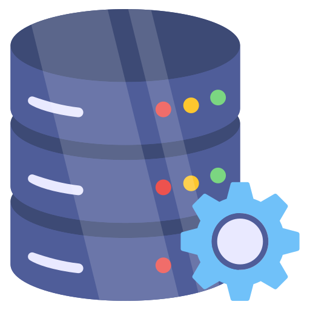
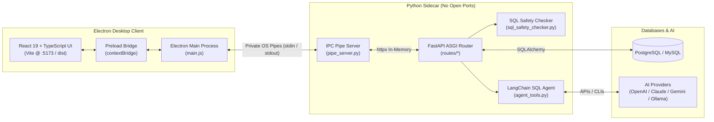

# CmdQ

<div align="center">



### Intelligent Database Administration & Schema Exploration Desktop Workstation

[](LICENSE)
[](package.json)
[](frontend/package.json)
[](frontend/package.json)
[](backend/requirements.txt)
[](backend/requirements.txt)
[](backend/requirements.txt)

<br/>


<p align="center">
  <b>CmdQ</b> is a modern, cross-platform desktop workstation for <b>PostgreSQL</b> and <b>MySQL</b>.<br/>
  It blends an <b>Electron + React 19</b> desktop client with a hardened <b>Python + LangChain</b> sidecar running over <b>private OS pipes</b>—delivering natural language SQL agents, visual ER diagrams, inline cell editing, and health diagnostics without opening local network ports.
</p>

</div>

---

## ⚡ Why CmdQ?

| | Capability | Why It Matters |
|---|---|---|
| 🔒 | **Zero-Port Private IPC** | No open `localhost` TCP sockets. The Python backend communicates via private OS `stdin`/`stdout` pipes, eliminating local network attack vectors and browser-based CSRF probes. |
| 🤖 | **Autonomous SQL Agent** | Natural language to SQL using LangChain ReAct agents (`execute_sql` tool). Supports **OpenAI**, **Claude**, **Gemini**, and local CLIs (**Ollama**, **GitHub Copilot**) with `@table` context parsing. |
| 🕸️ | **Interactive ER Graphs** | Auto-discovers schema topology with ReactFlow & Dagre. Detects 1:1, 1:N, and virtual M:N junction tables with layout toggles and high-res image export. |
| 🛡️ | **Unified Safety Guard** | Server-side protection policies (`Full`, `Read-Only`, `Custom`). Blocks unconstrained `DELETE`, `DROP`, and `TRUNCATE` operations across queries, AI prompts, and ETL jobs. |
| 📊 | **Automated Diagnostics** | One-click security audits (PII exposure, RLS inspection) and performance profiling (index vs. sequential scans, table bloat, cache ratios) with Recharts graphs. |
| 🔄 | **Cross-Database ETL & Copy** | One-click database cloning between PostgreSQL and MySQL instances, paired with a visual ETL migration wizard for field-level data transformations. |

---

## 🚀 Quick Start (Under 2 Minutes)

### Prerequisites
- **Node.js** `>= 18.0.0`
- **Python** `>= 3.10`
- Target **PostgreSQL** or **MySQL** instance (local or remote)

### 1. Clone & Setup
```bash
git clone https://github.com/e-Yasmina/CmdQ.git
cd CmdQ

# One-step automated install (installs both Python backend & Node frontend dependencies)
npm run setup
```

### 2. Launch CmdQ
```bash
npm start
```
*Electron will automatically spawn the private Python pipe server and launch the desktop application.*

---

## 🎯 Key Features at a Glance

### 🗄️ Database Explorer & Interactive Data Grid
- **Multi-RDBMS & Multi-Tab**: Connect simultaneously to PostgreSQL and MySQL servers. Open concurrent query tabs, table browsers, and analytic monitors.
- **In-Place Cell Editing**: Double-click any cell to edit directly with automatic parameterized `UPDATE` and optimistic UI updates.
- **Full-Featured Grid**: Multi-column sorting, row insertion/deletion, pagination (25 to 500 rows), fullscreen view (`Esc` toggle), and export to CSV, JSON, or SQL inserts.
- **CodeMirror SQL Editor**: Syntax highlighting, auto-completion, and execute shortcut (`Ctrl+Enter`).

### 🤖 Natural Language AI Assistant
- **ReAct SQL Agent**: Multi-turn conversational reasoning agent equipped with schema tools, bound query execution (up to 5,000 rows), and automated error correction.
- **Smart Context Ingestion**: Focus prompts using `@schema.table` syntax (e.g., `@public.orders`). CmdQ automatically injects only relevant table schemas and foreign-key neighbors.
- **Encrypted Model Registry**: Securely configure **OpenAI** (GPT-4o, custom endpoints), **Anthropic** (Claude 3.5), **Google Gemini**, or local CLIs (`ollama`, `chatgpt`, `gemini`, `gh`). API keys are encrypted at rest using machine-derived Fernet keys.
- **Autonomous Table Translation**: Translate foreign-language table schemas and row contents in place with structured AI pipelines.

### 🕸️ Visual Schema Topology (ER Graph)
- **Automated DAG Layout**: Hierarchical Left-to-Right (`LR`) or Top-to-Bottom (`TB`) layout powered by Dagre and ReactFlow.
- **Smart Relationship Tracing**: Classifies 1:1, 1:N, and detects virtual M:N relationships through junction tables.
- **Interactive Canvas**: Zoom, pan, search filter, minimap, column details (PK, FK, types, nullability), and one-click PNG diagram export.

### 🛡️ Unified SQL Safety & Table Protection
- **Multi-Level Protection Rules**:
  - **`Full`**: Table hidden from AI prompts; all reads/writes blocked.
  - **`Read-Only`**: Schema visible for analysis; all modifications (`INSERT`, `UPDATE`, `DELETE`, `DDL`) blocked.
  - **`Custom`**: Granular per-operation write access (e.g., allow `INSERT`, block `DELETE`).
- **PostgreSQL RLS Inspection**: Automatically detects Row Level Security policies and suggests required session settings (`SET search_path`, `SET app.user_id`).
- **Destructive Query Interceptor**: Blocks accidental `DELETE` without `WHERE`, unauthorized `DROP TABLE`, and `TRUNCATE`.

### 📊 Automated Database Diagnostics
- **Security Audit**: Scans for unmasked PII/credential columns (passwords, tokens, SSNs), superuser accounts, and missing RLS protections.
- **Performance Profiling**: Evaluates table size vs. index size, sequential vs. index scan ratios (`pg_stat_user_tables`), dead tuple buildup, and connection saturation.
- **Data Quality**: Evaluates primary key coverage, null distribution, cardinality metrics, and duplicate candidates.

### 🔄 Database Cloning & ETL Migrations
- **Cross-Database Copy**: Replicate database schemas and row data directly across PostgreSQL and MySQL instances.
- **Visual ETL Pipeline**: Map source-to-target fields with string transformations (`concat`, `split`) and type casts (`cast_int`, `cast_str`).
- **Import Pre-Scan**: Inspects CSV, JSON, and SQL files before import to predict affected row counts and flag destructive actions.

---

## 🏗️ Architecture at a Glance



- **Zero-Network Exposure**: The Python backend has no network listener or port. Communication happens entirely over anonymous OS pipes spawned by Electron.
- **Main-Process Allowlist**: `main.js` validates every request against a strict path allowlist and checks for directory traversal before piping to Python.
- **Atomic Concurrency**: User configurations (`~/.cmdq/`) use file-level locking (`portalocker`) to ensure multi-process integrity.

---

## 📋 Common Commands

| Task | Command | Description |
|---|---|---|
| **Full Setup** | `npm run setup` | Installs both backend (`requirements.txt`) & frontend packages |
| **Development** | `npm start` | Spawns Python sidecar, launches Vite dev server & opens Electron |
| **Backend Tests** | `npm test` | Runs the full 89-test Pytest suite (`backend/test_api.py`) |
| **Type Check** | `npm run typecheck` | Validates TypeScript across all frontend components |
| **Frontend Build** | `npm run build` | Compiles production assets into `frontend/dist/` |
| **Desktop Pack** | `npm run pack` | Bundles unpacked Electron executable directory |
| **Installer Dist** | `npm run dist` | Generates Windows NSIS installer & portable `.exe` (`dist-electron/`) |
| **Reset Processes**| `npm run nuke` | Force-terminates orphaned Electron, Node, or Python background tasks |

---

## ⚙️ Configuration & Storage

User configuration is stored locally under `~/.cmdq/` (`%USERPROFILE%\.cmdq\` on Windows):

- `connections.json`: Saved server connection parameters (passwords masked in UI/logs).
- `queries.json`: Saved SQL queries and snippets.
- `conversations.json`: AI chat history and session context.
- `protected_items.json`: Table protection rules and permissions.
- `registered_models.json`: AI models with machine-derived encrypted API keys.

*Optional Environment Variables:*
- `PYTHON_PATH`: Custom path to a Python executable (defaults to `backend/venv` or system `python`).

---

## 🤝 Contributing

1. **Fork** the repository and create your feature branch: `git checkout -b feature/my-feature`.
2. **Implement & Test**: Run `npm test` (backend) and `npm run typecheck` (frontend).
3. **Keep It Clean**: Ensure no open network ports are introduced; adhere to the private IPC pipe pattern.
4. **Submit a PR**: Provide a clear explanation of changes, rationale, and screenshots if applicable.

---

## 📄 License

This project is licensed under the **ISC License** — see [LICENSE](LICENSE) for details.

---

## 🌟 Acknowledgements

CmdQ is powered by open-source technologies:
- [Electron](https://www.electronjs.org/) & [React](https://react.dev/) — Desktop runtime and reactive user interface
- [FastAPI](https://fastapi.tiangolo.com/) & [SQLAlchemy](https://www.sqlalchemy.org/) — Asynchronous backend & database abstraction
- [LangChain](https://www.langchain.com/) — Multi-model ReAct agent framework
- [ReactFlow](https://reactflow.dev/) & [Dagre](https://github.com/dagrejs/dagre) — Schema topology graph rendering
- [CodeMirror](https://codemirror.net/) — Extensible in-app SQL code editor
- [Recharts](https://recharts.org/) — Composable analytics charts
